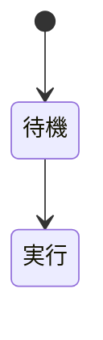

# ビジュアル基準デッキ

## #392 段 0 の固定用

---

# 図だけ

```diagram
type: flowchart
direction: LR
nodes:
  - id: a
    label: 受付
  - id: b
    label: 審査
edges:
  - from: a
    to: b
```

---

# 表だけ

| 項目 | 値 |
|---|---|
| 売上 | 100 |
| 利益 | 20 |

---

# コードだけ

```ts
const answer = 42;
console.info(answer);
```

---

# 画像だけ


---

# 画像の属性つき

- 本文の箇条

{x=1.5,y=2,w=4,h=3,fit=cover,ar=1.333}

---

# 背面画像

- 前面の本文

{behind=1}

---

# 本文と図

- 左の説明
- もう一行

```diagram
type: flowchart
nodes:
  - id: x
    label: X
  - id: y
    label: Y
edges:
  - from: x
    to: y
```

---

# 本文と表

- 表の説明

| 列A | 列B |
|---|---|
| 1 | 2 |

---

# 本文とコード

- コードの説明

```py
print("hi")
```

---

# 表と図（現状は重なる）

| 指標 | 値 |
|---|---|
| A | 1 |

```diagram
type: flowchart
nodes:
  - id: p
    label: P
  - id: q
    label: Q
edges:
  - from: p
    to: q
```

---

# col 本文｜図

<!-- col -->
- 左カラムの本文
- 二行目

<!-- col -->
```diagram
type: flowchart
nodes:
  - id: m
    label: M
  - id: n
    label: N
edges:
  - from: m
    to: n
```

---

# col 表｜図

<!-- col -->
| k | v |
|---|---|
| a | 1 |

<!-- col -->
```diagram
type: flowchart
nodes:
  - id: s
    label: S
```

---

# col 本文｜画像

<!-- col -->
- 画像の説明

<!-- col -->


---

# 図が 2 つ（現状は先の図が落ちる）

```diagram
type: flowchart
nodes:
  - id: one
    label: 一つ目
```

```diagram
type: flowchart
nodes:
  - id: two
    label: 二つ目
```

---

# Mermaid


